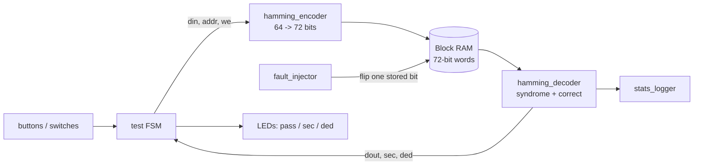

# Hamming SECDED ECC for On-Chip SRAM (Spartan-7)


A synthesizable Verilog implementation of a **Hamming SECDED** (single-error-correct, double-error-detect)
codec wrapped around FPGA Block RAM, with a fault-injection port, a board-level demo for the
RealDigital Boolean Board (Xilinx Spartan-7 `xc7s50csga324-1`), a Python golden model, and a
verification flow that is itself tested.

Two code widths are implemented and compared: **Hamming(72,64)** (64-bit words, the real-world SRAM/DRAM
configuration) and **Hamming(13,8)** (8-bit words).

The question this project answers with measurements: *what does a SECDED decoder actually do when it
receives more errors than it was designed for?*

## Status (what is and is not done)

| Item | Status |
|---|---|
| RTL: encoder, decoder, ECC-protected SRAM wrapper, fault injector, stats counters, board demo | done |
| Simulation (Icarus Verilog): 64-bit SRAM, 13-bit codec, board-level button-to-LED test | done, logs in [`results/`](results) |
| Python golden model, exhaustive sweeps, cross-checked against RTL | done |
| Testbench self-test (a broken fault injector must make the testbench fail) | done |
| CI: `make test` on every push | done |
| Vivado elaboration and synthesis | done (schematic in [`docs/img`](docs/img)); utilization/timing numbers not yet recorded |
| Re-run of the updated testbenches in Vivado xsim | **pending** |
| Implementation, bitstream, **on-board validation** | **pending** - see [`docs/HARDWARE_VALIDATION.md`](docs/HARDWARE_VALIDATION.md) |

## Results

Fault-injection sweep on the **RTL** (Hamming(72,64), 200 trials per row, every trial's injection independently
verified by reading the stored codeword back):

| Injected errors | Corrected | Detected (uncorrectable) | Silently miscorrected |
|---|---|---|---|
| 1 bit | 200 | 0 | 0 |
| 2 bits | 0 | 200 | 0 |
| 3 bits | 0 | 0 | 200 |

Exhaustive sweeps (every possible error pattern) from the golden model, which reproduces the RTL's own
exhaustive (13,8) sweep exactly:

| Code | 1-bit errors | 2-bit errors | 3-bit errors |
|---|---|---|---|
| Hamming(13,8), overhead 62.5% | 13/13 corrected | 78/78 detected | 286: **284 miscorrected**, 2 harmless, 0 detected |
| Hamming(72,64), overhead 12.5% | 72/72 corrected | 2,556/2,556 detected | 59,640: **59,625 miscorrected (99.975%)**, 15 harmless, 0 detected |

**Within its guarantee (up to 2 errors) the code is perfect. Beyond it, it fails silently**: with 3 errors the
decoder reports "corrected" and returns wrong data, and the double-error flag never fires. This is a property of
the decision rule (an odd number of errors always fails the overall parity check, so the decoder can never reach
its double-error branch), not a bug. Details and a possible mitigation are in
[`docs/VERIFICATION.md`](docs/VERIFICATION.md).

Overhead falls with word width (parity grows as O(log k)): 5 extra bits for 8 data bits (62.5%) vs 8 extra bits
for 64 data bits (12.5%).

## Architecture



Full description, bit layout, equations and a worked example: [`docs/DESIGN.md`](docs/DESIGN.md).

## Repository layout

```
rtl/sram64/        Hamming(72,64) design: encoder, decoder, SRAM wrapper, fault injector, stats, board top
rtl/codec13_8/     Hamming(13,8) encoder/decoder (clk/rst/enable interface)
tb/                testbenches: 64-bit sweep, 13-bit exhaustive sweep, board-level button-to-LED test
model/             Python golden model (generic in data width)
scripts/           results checker, testbench self-test, single-file generator
vivado/            generated single-file design for a quick Vivado project
constraints/       boolean_board.xdc (RealDigital Boolean Board pin map)
results/           simulation and model logs from `make test`
docs/              design, verification, debugging log, Vivado guide, hardware validation, reports, figures
```

## Quick start (simulation, no FPGA needed)

Requires `iverilog` and `python3`.

```bash
make test      # RTL sims + golden model + cross-check + testbench self-test
make single    # regenerate vivado/ecc_sram_top.v and check it compiles
```

`make test` ends with `ALL CHECKS PASSED`. It fails if the RTL disagrees with the golden model, if any injected
fault did not actually land, or if the testbench stops detecting a deliberately broken fault injector.

## Vivado / board

See [`docs/VIVADO_GUIDE.md`](docs/VIVADO_GUIDE.md). In short: part `xc7s50csga324-1`, design source
`vivado/ecc_sram_top.v`, constraints `constraints/boolean_board.xdc`, top module `top_ecc_demo`, simulation
sources `tb/*.v`, and set the simulation run time to `-all`.

## Debugging highlights

The verification flow exists because of real failures, documented in [`docs/DEBUGGING.md`](docs/DEBUGGING.md):

- A fault-injection sweep in Vivado reported identical results for 1, 2 and 3 errors. Root cause: the fault port
  received an undefined address so no fault ever landed, and the testbench counted "no flag, data intact" as
  "corrected". The new testbench verifies every injection independently.
- Simulating the board demo (buttons to LEDs) showed the LEDs were always one operation behind, because the FSM
  latched flags before the new result had propagated. Fixed and covered by a regression test.

## Limitations and next steps

- On-board validation and post-synthesis resource/timing numbers are still to be added.
- The decoder treats a syndrome pointing outside the codeword as a harmless "single error". In the golden model
  about 24% of 3-bit error patterns produce such a syndrome, so flagging it as uncorrectable would detect them.
  Not implemented or verified in RTL yet.
- Next: BCH(t=2) comparison, adjacent-multi-bit-upset fault model, memory scrubbing with a second port.

## Reports

[`docs/reports/`](docs/reports): IEEE-format paper draft, slides, and the RTL-design lab report.

## References

1. R. W. Hamming, "Error detecting and error correcting codes," *Bell Syst. Tech. J.*, vol. 29, no. 2, pp. 147-160, 1950.
2. M. Y. Hsiao, "A class of optimal minimum odd-weight-column SEC-DED codes," *IBM J. Res. Develop.*, vol. 14, no. 4, pp. 395-401, 1970.
3. C. L. Chen and M. Y. Hsiao, "Error-correcting codes for semiconductor memory applications: a state-of-the-art review," *IBM J. Res. Develop.*, vol. 28, no. 2, pp. 124-134, 1984.
4. R. C. Baumann, "Soft errors in advanced computer systems," *IEEE Des. Test Comput.*, vol. 22, no. 3, pp. 258-266, 2005.

## License

MIT - see [`LICENSE`](LICENSE). Author: Aayush Attal, Vidyalankar Institute of Technology.
